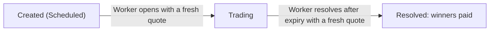

# Atlas Perpetual and Prediction Markets

USDC-collateralized smart contracts for leveraged perpetual trading and binary
Up/Down prediction rounds on EVM networks. Atlas signed pull-oracle quotes
verify prices supplied with each transaction. Liquidity providers fund separate
vaults and receive LP tokens representing their shares.

## Contracts

| Contract | Purpose | LP token |
| --- | --- | --- |
| [PerpDexAtlas](src/PerpDexAtlas.sol) | Leveraged long/short positions, TP/SL, liquidation, and pooled liquidity | [ppUSDC](src/ppUSDC.sol) |
| [PredictionMarketAMMAtlas](src/PredictionMarketAMMAtlas.sol) | Binary Up/Down rounds with fixed winning payouts and automatic settlement | [pmUSDC](src/pmUSDC.sol) |
| [AtlasMarketOracle](src/oracle/AtlasMarketOracle.sol) | Shared signature and price validation for Atlas prediction and option vaults | — |
| [MockUSDC](src/MockUSDC.sol) | Six-decimal test collateral with owner minting and a one-time faucet per wallet | — |

The perpetual and prediction vaults have independent liquidity, accounting, and
LP token supplies. Deployment scripts create fresh LP tokens for each vault.
The repository also includes [Atlas options](docs/atlas-markets.md), Pyth-based
markets, and [EIP-7702 trading accounts](docs/eip7702.md).

## Perpetual trading

`PerpDexAtlas` lets users open long or short positions using USDC margin. The
vault pays trader profits from its liquidity pool and retains trader losses.

- Leverage, position limits, liquidity allocation, and maximum take-profit are
  configured per pair.
- Users can open/close positions and update take-profit and stop-loss levels.
  Keepers trigger eligible TP/SL orders and liquidate positions using signed
  quotes. These actions require transactions; price changes alone do not execute
  orders.
- Profitable closes charge **3.5% of realized profit**: 1.5% goes to the platform
  vault and 2% stays with LPs. Losing and break-even closes have no winning-profit
  fee. Opening and funding fees are currently disabled.
- LPs approve USDC and call `depositLP(amount)` to receive `ppUSDC`, then use
  `withdrawLP(shares)` to redeem subject to liquidity checks.
- Profit reservations, pair liquidity limits, and a 30% drawdown circuit breaker
  constrain exposure. LP returns depend on trading results and fees.

The owner manages pairs, risk parameters, pauses, and the Atlas signer.
Perpetual trading and keeper actions do not require prediction-worker
permissions. See the [perpetual deployment and API guide](docs/perpdex-atlas.md).

## Prediction rounds

`PredictionMarketAMMAtlas` is the counterparty to each Up/Down bet. Users pay
USDC and receive an internal, nontransferable balance equal to their fixed gross
payout if they win. **Up wins when closing price >= opening price**; otherwise
Down wins.

### Backend worker flow



1. The owner calls `authorizeBackend(worker, true)`.
2. The owner or authorized worker calls
   `createMarket(pairId, duration, volatilityBps)` at any time.
3. `openMarket(marketId)` verifies a fresh Atlas quote and starts the round:
   `startTime = block.timestamp`, `endTime = startTime + duration`.
4. Users call `buy(...)` before the five-second trading cutoff.
5. At or after expiry, the worker calls `resolveMarket(marketId)` with a fresh
   quote published at or after expiry. Settlement pays winners, clears outcome
   balances, and releases the round's collateral reservation.

Creation, opening, and resolution require the owner or an authorized backend.
There is no UTC alignment or opening deadline. The worker sends transactions;
the contract does not initiate them automatically.

**Settlement uses the price when the worker executes.** No archived quote from
the exact expiry second is required. A delayed worker can change the outcome
compared with the price observed at expiry, so it controls settlement timing
and must follow the intended policy. Quotes must still be at most five seconds
old.

### Payouts and liquidity

| Setting | Behavior |
| --- | --- |
| Round duration | 5 minutes, 15 minutes, 1 hour, or 1 day |
| Annualized volatility | 100–50,000 bps; fixed when the round is created |
| Prediction fee | Fixed at deployment; defaults to 300 bps (3%), maximum 500 bps (5%) |
| Odds | Price, time remaining, and volatility determine payout; supported model probabilities are 1%–95% |
| Collateral | Maximum of Up/Down outstanding payouts reserved per round; total utilization capped at 80% |
| Participants | Maximum 128 distinct bettors per round |
| LP token | `pmUSDC`, created by the vault; read its address with `shareToken()` |

At the opening price, both directions have 50% model probability. With a 3% fee,
a 100 USDC stake has a gross winning payout of **194 USDC**, including the stake.
The odds model is a heuristic, not a calibrated forecast.

LPs use `deposit(assets, minShares)` and `withdraw(shares, minAssets)`. Deposits
and withdrawals are locked while any round has unresolved exposure. Winners
receive USDC during resolution without a claim transaction. A failed winner
transfer reverts the entire resolution; balances and reserves remain intact
until a successful retry.

See [Atlas prediction integration](docs/atlas-markets.md#prediction-worker-driven-rounds).

## Atlas oracle and units

Append Atlas signed `extraData` to the end of each price-sensitive vault call's
calldata. For batched execution, append it to the inner vault call. Atlas methods
are nonpayable and require no native oracle update fee; network gas still applies.

| Value | Format |
| --- | --- |
| USDC amounts and Atlas perp/prediction LP shares | 6 decimals; 1 USDC = `1e6` |
| Atlas feed ID | `bytes4` |
| Signed Atlas prices | 18 decimals |
| Perpetual TP/SL arguments and stored position prices | 8 decimals; Atlas prices are scaled down |
| Prediction `currentPrice`, opening price, and closing price | 18 decimals |
| Prediction probability | `1e18` scale |

Perpetual freshness is fixed at deployment with `ATLAS_MAX_PRICE_AGE` (1–5
seconds). Prediction freshness is fixed at five seconds. Both verify the
configured signer and feed, reject future/stale timestamps, and prevent accepted
feed timestamps from moving backwards. Prediction also rejects conflicting
prices at the same timestamp.

Use the generated ABI for each deployed contract. Prediction's three-argument
`createMarket`, `Market` tuple, and lifecycle events follow the worker flow above.
These vaults require new deployments to adopt contract changes.

## Setup

Install Foundry, then initialize dependencies and build:

```bash
git submodule update --init --recursive
forge build --sizes
```

If Git Bash cannot find Foundry, run:

```bash
export PATH="$PATH:$HOME/.foundry/bin"
forge --version
```

Create a local `.env` using [.env.example](.env.example) and configure:

```dotenv
PRIVATE_KEY=0xYOUR_DEPLOYER_PRIVATE_KEY
RPC_URL=https://your-rpc-url
CHAIN_ID=YOUR_CHAIN_ID
USDC_ADDRESS=0xYOUR_SIX_DECIMAL_USDC_ADDRESS
ATLAS_SIGNER=0xYOUR_TRUSTED_ATLAS_SIGNER
ATLAS_MAX_PRICE_AGE=5
PREDICTION_FEE_BPS=300
```

`ATLAS_SIGNER` identifies the trusted signing EOA. Fetch signed payloads through
the backend or transaction client. Keep private keys and API credentials in the
local environment, outside source control.

Load the environment for direct Foundry commands:

```bash
set -a
source <(tr -d '\r' < .env)
set +a
export FOUNDRY_PROFILE=default
```

### Optional: fresh test USDC

Atlas runners use the configured `USDC_ADDRESS`. To create a fresh test token:

```bash
forge create src/MockUSDC.sol:MockUSDC \
  --rpc-url "$RPC_URL" --private-key "$PRIVATE_KEY" --broadcast
```

Save the confirmed token address as `USDC_ADDRESS` in `.env` and reload the
environment before direct deployment commands. `MockUSDC` has owner minting and
a public faucet. Atlas runners do not deploy it from `DEPLOY_MOCK_USDC`.

## Deploy

Run commands from the repository root. Direct Foundry commands require the
loaded environment above; Bash runners load their environment file themselves.

### Perpetual vault only

```bash
# Check the RPC chain ID matches CHAIN_ID.
cast chain-id --rpc-url "$RPC_URL"

# Simulate, then deploy the vault and a fresh ppUSDC token.
forge script script/DeployPerpDexAtlas.s.sol --rpc-url "$RPC_URL"
forge script script/DeployPerpDexAtlas.s.sol --rpc-url "$RPC_URL" --broadcast --slow
```

### Prediction vault only

```bash
bash script/deploy/deploy-prediction-atlas.sh .env --dry-run
bash script/deploy/deploy-prediction-atlas.sh .env --broadcast
```

The prediction runner deploys the vault and its fresh `pmUSDC`. It checks the RPC
chain ID and supports `--broadcast --resume` for a saved deployment, or
`--broadcast --start-fresh` to archive an unfinished broadcast and deploy anew.
Inspect confirmed receipts and the deployer's nonce before choosing recovery.
The runner does not update `.env`.

### Combined Atlas deployment

The combined runner deploys **perpetual, prediction, and option** vaults, each
with a fresh LP token:

```bash
bash script/deploy/deploy-atlas.sh .env --dry-run
bash script/deploy/deploy-atlas.sh .env --broadcast
```

Save addresses from confirmed receipts:

| Environment variable | Address |
| --- | --- |
| `PERPDEX_ATLAS_ADDRESS` | Perpetual vault |
| `ATLAS_PPUSDC_ADDRESS` | Its fresh `ppUSDC` token |
| `PREDICTION_MARKET_AMM_ATLAS_ADDRESS` | Prediction vault |
| `ATLAS_PMUSDC_ADDRESS` | Prediction `shareToken()` |

Combined deployments also require `OPTION_AMM_ATLAS_ADDRESS` and
`ATLAS_OPUSDC_ADDRESS`. After recording all six vault/token addresses and
`USDC_ADDRESS`, run `bash script/deploy/verify-atlas.sh .env` to verify the full
Atlas deployment. The verifier requires all three vaults.

## Register markets and fund liquidity

Initial registries are empty. Simulate and seed each deployed vault:

```bash
bash script/deploy/seed-atlas-pairs.sh .env perp --dry-run
bash script/deploy/seed-atlas-pairs.sh .env perp --broadcast
bash script/deploy/seed-atlas-pairs.sh .env prediction --dry-run
bash script/deploy/seed-atlas-pairs.sh .env prediction --broadcast
```

The seeder requires ownership and an empty registry. It registers 15 configured
markets in both perpetuals and prediction:

| Group | Markets | Initial perpetual max leverage | Max position size |
| --- | --- | --- | --- |
| Major crypto | BTC, ETH, SOL | 500x | 500,000 USDC |
| Other crypto | BNB, HYPE, DOGE, XRP, ZEC | 250x | 500,000 USDC |
| Stocks | AAPL, MSFT, AMZN, GOOGL, META, NVDA, TSLA | 100x | 50,000 USDC |

These are seeder defaults; owners can change perpetual risk settings. Prediction
uses ticker pair names; perpetuals use `TICKER_USD`. Feed overrides use
`ATLAS_*_FEED_ID` in `.env.example` and must be unique, nonzero `bytes4` values.
The default BTC feed is quoted in USDT and consumed directly without a USDT/USD
conversion. See [initial feed/risk configuration](script/AtlasInitialPairConfig.sol).

After seeding, approve USDC for the vault and deposit liquidity. Authorize the
prediction worker with `authorizeBackend(worker, true)` before it creates,
opens, or resolves rounds. The owner can also perform these actions. Perpetual
keepers submit fresh signed quotes for eligible TP/SL and liquidation calls.

## Tests and documentation

```bash
# Atlas perpetual and prediction contracts, oracle, and deployments.
forge test --match-contract 'PerpDexAtlasTest|PredictionMarketAMMAtlasTest|AtlasMarketOracleTest|DeployPerpDexAtlasTest|DeployAtlasMarketsTest|DeployAtlasTest|ConfigureAtlasPairsTest' -vv

# Prediction deployment runner, using mocked Foundry commands.
bash test/scripts/deploy-prediction-atlas.sh

# Complete contract suite.
forge test -vv
```

Tests cover signed quotes, freshness, units, signer rotation, accounting,
payouts, worker permissions, delayed settlement, LP reserves, deployment wiring,
and runtime size limits. The default build uses Solidity 0.8.20, optimizer runs
1, and `via_ir`; see [foundry.toml](foundry.toml).

- [Perpetual deployment and API](docs/perpdex-atlas.md)
- [Atlas prediction and option integration](docs/atlas-markets.md)
- [Full deployment reference and other networks](docs/deployment-reference.md)
- [EIP-7702 account integration](docs/eip7702.md)
- [Option pricing and SDK](docs/option-pricing.md)
